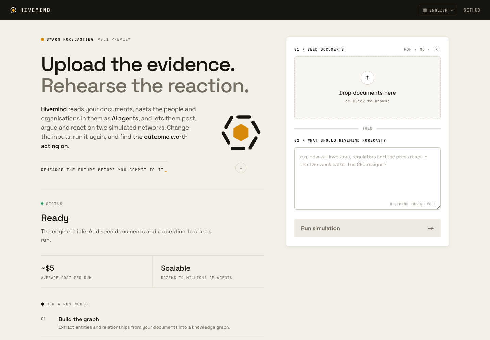
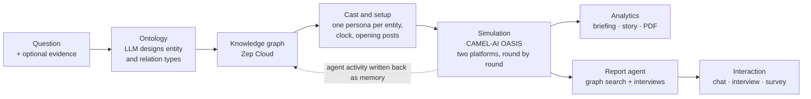
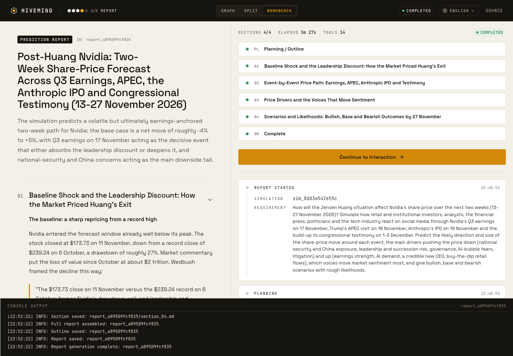

<div align="center">

<picture>
  <source media="(prefers-color-scheme: dark)" srcset="./brand/logo-dark.svg">
  
</picture>

**Social swarm simulation. Build a fake internet around any event and watch how it reacts.**

[English](./README.md) | [中文文档](./README-ZH.md)

### [Try it live → hivemind-production-25f13fa5.up.railway.app](https://hivemind-production-25f13fa5.up.railway.app)

<sub>Free public demo: 5 new runs a day across all visitors, 10 rounds each. Earlier runs are open to browse.</sub>

</div>

Hivemind turns a question into a simulated public. Give it a situation (a question on its
own, or a question with documents) and it maps the people and organisations involved into a
knowledge graph, turns each of them into an AI agent with a persona and a memory, and lets
them post, reply, like and argue on two simulated social platforms, round by round. When the
rounds end it tells you, in plain language, where the simulated voices agreed, where they
split and how each group would likely respond, and lets you question the report agent or
interview any simulated participant. It works for announcements, policies, scandals, price
changes or rulings. Every participant is simulated: it is a rehearsal of how reaction might
unfold, not a record of real events and not a prediction you should act on.



## What a run produces

- **A knowledge graph** of the people, organisations and relationships in the situation, built
  in Zep Cloud from your documents or from a background brief the model writes.
- **A cast of AI agents**, typically 25 to 80: one per entity in the graph, plus the people
  around the key actors and newcomers drawn in as the conversation grows (always labelled as
  added, and capped).
- **Two simulated platforms' worth of activity**: posts, comments, likes, dislikes, reposts,
  quotes, follows and mutes on a Twitter-like feed and a Reddit-like forum, logged per round.
- **An Analytics page**: a plain-language briefing, the story of the run, the cast as a tree,
  a run-health check, conversation trees, an influence network you can replay round by round,
  rankings and activity charts.
- **A briefing PDF** to share: the bottom line and how far to trust it, consensus and splits,
  each group's and each company's reaction and likely next move, what to watch, the story of
  the run, and diagnostics.
- **A long-form report** written by a report agent that searches the graph and interviews the
  simulated people.
- **Conversation**: chat with the report agent at any time; interview any simulated person, or
  survey many at once, while their run is still live.

## How it works



| Stage | What happens |
| --- | --- |
| **1. Knowledge graph** | The model reads your documents and question (or writes a background brief when there are none) and designs an ontology: 10 kinds of actor and the relationships between them. Zep extracts the entities and relationships into a temporal knowledge graph. |
| **2. Agent setup** | Every typed entity in the graph becomes an agent with a written persona. The model sets the simulated clock, writes the opening posts in the right voices, and sets each agent's activity. Hivemind adds the people immediately around the key actors. |
| **3. Simulation** | A separate OASIS process runs both platforms in parallel. Each round, a random set of awake agents reads its feed and the model chooses an action for each. Newcomers can join mid-run. Every action is logged and written back into the graph as memory. After the last round the agents stay alive for interviews. |
| **4. Report** | A report agent plans 2 to 5 sections and writes each with graph-search and live-interview tools. |
| **5. Interaction** | Chat with the report agent, talk to any simulated person, or survey many at once. |

The full walk-through, with every prompt, file and limit, is in
[docs/PIPELINE.md](./docs/PIPELINE.md). How the processes fit together is in
[docs/ARCHITECTURE.md](./docs/ARCHITECTURE.md).

## Feature tour

| | |
| --- | --- |
|  |  |
| **Knowledge graph.** The entities and relationships Zep extracted, sized by how connected they are. | **Simulation.** Both platforms' actions as they happen, with the graph alongside. |
|  |  |
| **Report.** Written section by section, with the agent's tool calls visible as it works. | **Interaction.** Chat with the report agent, interview one person, or survey many. |

**Start from a question.** Only the question is required. Add evidence by uploading files
(PDF, Markdown, text), pasting text, or (locally) pulling a live situation brief. With no
evidence, Hivemind writes a background brief from what the model already knows and says so at
the top; add documents for anything recent or private.

**The briefing.** When a run finishes, the Analytics page opens with a briefing for a
decision-maker: the bottom line and how far to trust it (Solid, Directional or Thin, from the
run's own health checks), where the simulated voices agree and split, how each group
(companies, government, investors, media, experts, the public) reacted and what it would likely
do next, each company's position, and what to watch. The facts underneath are computed from
the logs; the model only interprets them, and a template writes the same shape when no model
is available. **Download briefing PDF** gives the same thing as a document.

**Simulation analytics.** `/simulation/<id>/analytics` shows how the run unfolded: who engaged
with whom (an influence network with round-by-round replay), activity per round, the top
influencers and most-engaged posts, the action mix, conversation trees, a run-health card
(feed visibility, participation, feed concentration, branching, horizon) and a per-agent
drill-down. It refreshes every 5 seconds while a run is live. Every metric is defined in
[docs/ANALYTICS.md](./docs/ANALYTICS.md).


## Quick start

You need Node.js 20.19 or newer (22 recommended), Python 3.12 and
[uv](https://docs.astral.sh/uv/), and two keys of your own:

| Key | What it is for | Where to get it |
| --- | --- | --- |
| `LLM_API_KEY` | Claude, which plays every simulated participant and writes the write-ups | [console.anthropic.com](https://console.anthropic.com/) → API keys |
| `ZEP_API_KEY` | The knowledge graph and agent memory | [app.getzep.com](https://app.getzep.com/) (the free tier is enough for small runs) |

```bash
git clone https://github.com/slimboi34/hivemind.git
cd hivemind
./hivemind.sh       # first run creates .env and tells you which two lines to fill in
```

Put your two keys in `.env` and run `./hivemind.sh` again. It installs what is missing and
starts both servers:

- App: http://localhost:3000
- API: http://localhost:5001

Your keys live only in `.env`, which is gitignored. The model is `LLM_MODEL_NAME`
(`claude-haiku-5-5` in the template); any OpenAI-compatible provider works, see
[docs/CONFIGURATION.md](./docs/CONFIGURATION.md).

**Your first run:** type a question on the home screen and press **Run simulation**. No
documents are needed. On the agent setup screen leave the rounds on auto: unless you pick a
custom number, the backend plays at most 10 rounds, which keeps the run quick and cheap (every
participant makes a model call every round). When it finishes, open **Analytics** and press
**Download briefing PDF**.

Tests: `cd backend && uv run pytest`. More in [docs/DEVELOPMENT.md](./docs/DEVELOPMENT.md).

## Documentation

| Document | What it covers |
| --- | --- |
| [Architecture](./docs/ARCHITECTURE.md) | Components, the process model (Flask, the OASIS subprocess, file-based IPC, the kept-alive environment), data flow, what is stored on disk, external services, design decisions |
| [Pipeline](./docs/PIPELINE.md) | Each stage in depth: endpoints, code, what the model is asked, what is written, time and cost drivers |
| [API reference](./docs/API.md) | Every HTTP endpoint, its parameters and response, and what the public site allows |
| [Analytics](./docs/ANALYTICS.md) | Every metric on the Analytics page, the briefing, the recap and the PDF, and exactly how each is computed |
| [Configuration](./docs/CONFIGURATION.md) | Every environment variable, its default and effect |
| [Deployment](./docs/DEPLOYMENT.md) | The public site: policy and guards, the Docker image, Railway, persistence, loading history, the source offer, cost control, operations |
| [Development](./docs/DEVELOPMENT.md) | Running locally, tests, a code tour, localisation, adding a feature, conventions |
| [Limitations](./docs/LIMITATIONS.md) | What the output does and does not mean, and the known weaknesses |
| [Brand](./docs/BRAND.md) | The brand kit and how the product applies it |
| [Research: agent architecture](./docs/research/AGENT_ARCHITECTURE.md) | A review of how agents are created and a ranked rebuild plan |
| [Research: information dynamics](./docs/research/INFORMATION_DYNAMICS.md) | How information spreads between agents, measured on stored runs, with a plan to make it accurate |
| [Maintainer notes](./HIVEMIND.md) | Working notes: what Hivemind adds, the public site, next steps |

## Engineering notes

A few decisions worth knowing about, each explained in the docs:

- **The simulation runs in its own process** and the API talks to it through files: command
  and response folders, an append-only action log and a status file. After the last round the
  process stays alive so the report agent and users can interview the same agents with their
  memories. ([Architecture](./docs/ARCHITECTURE.md#process-model))
- **Measurement never changes the prediction.** Every analytics module only reads what a run
  already wrote. ([Analytics](./docs/ANALYTICS.md))
- **Facts first, then prose.** The briefing and the story are computed from the logs; the model
  only interprets those facts, its JSON is validated, a template covers failures, and results
  are cached against the data they describe. ([Analytics](./docs/ANALYTICS.md#the-briefing-briefing))
- **The engine is patched, not forked.** Three OASIS defects (a quote-post crash that left up to
  46% of agent turns with an empty feed, silent feed errors, and an embedding pass that ran out of memory) are fixed
  at runtime, each guarded so a library upgrade cannot break it. ([Pipeline](./docs/PIPELINE.md#inside-the-subprocess))
- **Zep writes are idempotent by design.** Graph and batch identities are generated and saved
  before the call, so a lost reply is reconciled instead of duplicated.
  ([Architecture](./docs/ARCHITECTURE.md#concurrency-and-safety))
- **The public site is one guard in front of everything**: run and chat quotas, read-only
  history and one simulation at a time, enforced in a single `before_request` hook with usage
  persisted on the volume. ([Deployment](./docs/DEPLOYMENT.md#public-mode-policy))

## Tech stack

| Layer | Technology |
| --- | --- |
| Frontend | Vue 3, Vite 7, vue-router, vue-i18n, D3, axios |
| Backend | Python 3.12, Flask 3, flask-cors, served by waitress; dependencies locked with uv |
| Simulation engine | CAMEL-AI OASIS 0.2.5 (camel-ai 0.2.78), PyTorch (CPU), `Twitter/twhin-bert-base` for the feed recommender |
| Knowledge graph and memory | Zep Cloud (`zep-cloud` 3.25.0) |
| Language model | Claude Haiku 5.5 through Anthropic's OpenAI-compatible API, via the `openai` SDK; any OpenAI-compatible provider works |
| Documents and PDF | PyMuPDF |
| Tests and CI | pytest (offline, about 270 tests), GitHub Actions |
| Hosting | Docker (multi-stage image), Railway with a persistent volume |

## Project layout

```
backend/    Flask API (app/), the OASIS simulation scripts (scripts/), tests (tests/)
frontend/   Vue 3 + Vite app (design system in src/styles/hivemind.css)
locales/    UI strings shared by frontend and backend (English is the default)
deploy/     Dockerfile for the public site
brand/      The Hivemind brand kit: logo, mark, app icon and brand board
docs/       Documentation, screenshots, brand guide and research notes
```

A file-by-file tour is in [docs/DEVELOPMENT.md](./docs/DEVELOPMENT.md#code-tour).

## Licence

Licensed under the [GNU AGPL-3.0](./LICENSE). If you run a modified version as a network
service, you must offer its source to your users.

Portions of this software derive from an open-source project released under the same
licence; this notice is kept as that licence requires. Agent simulation is powered by
[CAMEL-AI OASIS](https://github.com/camel-ai/oasis).
