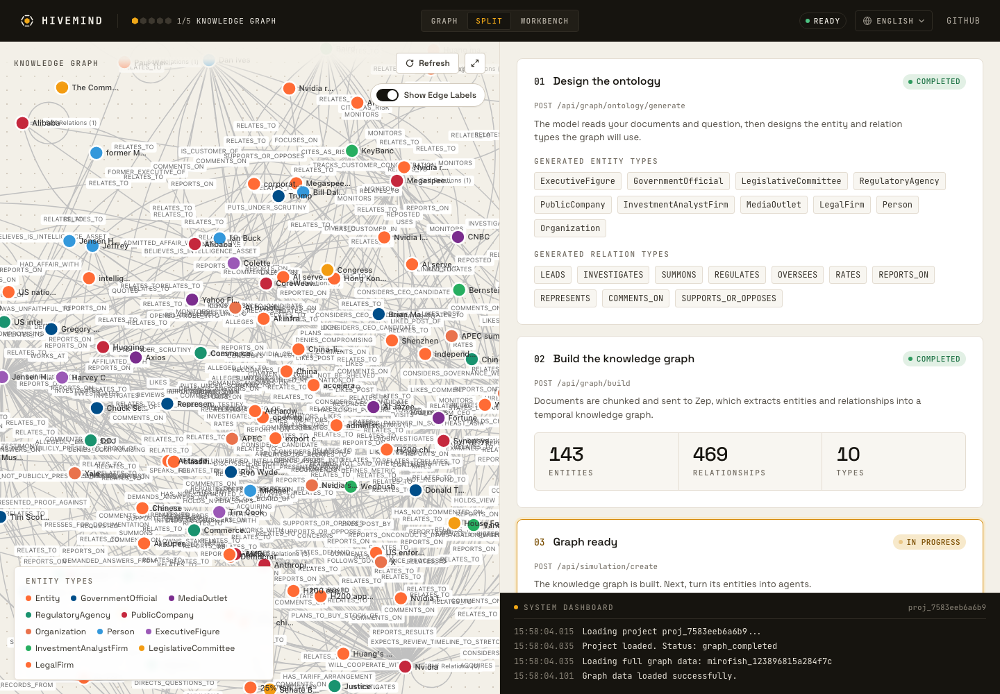
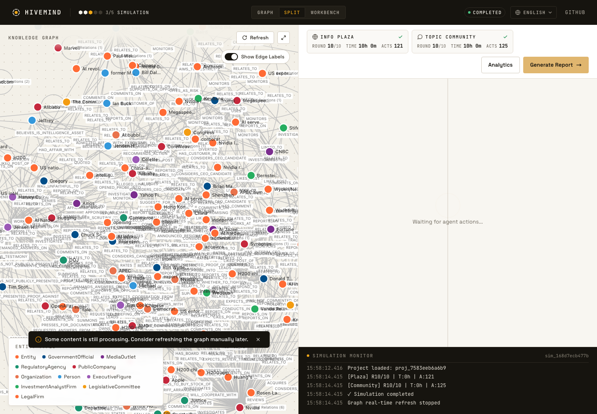
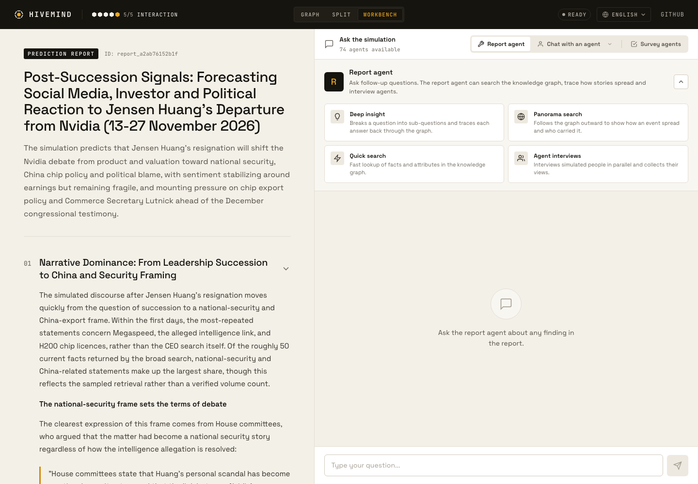
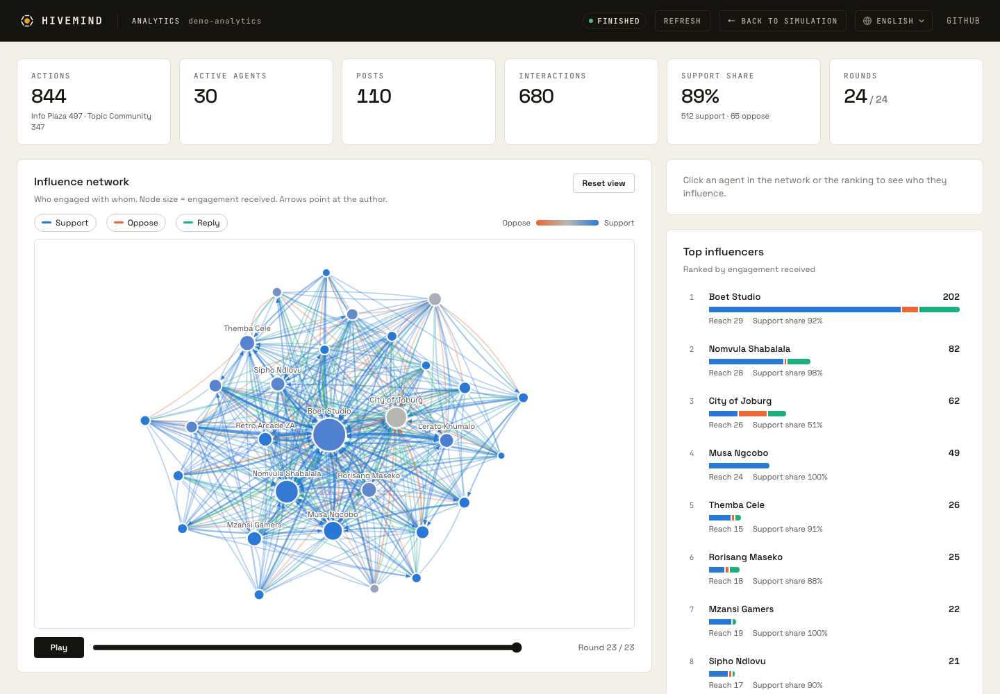

<div align="center">

<picture>
  <source media="(prefers-color-scheme: dark)" srcset="./brand/logo-dark.svg">
  
</picture>

**Swarm forecasting. Ask the question, rehearse the reaction.**

[English](./README.md) | [中文文档](./README-ZH.md)

</div>

Hivemind turns a set of documents into a simulated public. It reads your sources, builds a
knowledge graph of the people and organisations in them, and casts each one as an AI agent
with a background, memories and a stance. The agents post, reply, like and argue on two
simulated social platforms, round by round. A report agent then studies what happened and
writes a forecast. You can question it, or interview any agent directly.

Use it to rehearse how investors, regulators, the press or the public might react to an
announcement, a policy or a crisis before it happens.


## How a run works

| Stage | What happens |
| --- | --- |
| **1. Knowledge graph** | The model reads your documents and question, designs an ontology, and Zep extracts entities and relationships into a temporal knowledge graph. |
| **2. Agent setup** | Entities become agent personas, and the model configures the simulated clock, the feed algorithms and each agent's activity. |
| **3. Simulation** | Agents act on two platforms in parallel (a Twitter-like feed and a Reddit-like community), and their actions are written back into the graph as memory. |
| **4. Report** | A report agent with graph-search and interview tools writes a structured forecast. |
| **5. Interaction** | Chat with the report agent, talk to any simulated person, or survey many at once. |

| | |
| --- | --- |
|  |  |
|  |  |

### Start from a question

Only the question is required. Add evidence by uploading files, pasting text or pulling a live
brief, or add none: Hivemind then writes a background brief from what the model already knows
and uses that as the seed. That brief can be out of date, so add documents for anything recent
or private.

### The briefing

When a run finishes, the Analytics page opens with a plain-language briefing, and **Download
briefing PDF** gives you the same thing as a document to share:

- the bottom line, and how far to trust it
- where the simulated voices agree, and where they split
- how each group reacted (companies, government, investors, media, the public) and what it would likely do next
- each company's position and likely move
- what to watch, the story of the run, and run diagnostics as an appendix

### Simulation analytics

`/simulation/<id>/analytics` shows how a run unfolded. It is a read-only view of the logged
agent actions.

- An influence network (who engaged with whom) with round-by-round replay
- Activity per round, stacked by kind
- The top influencers and the most-engaged posts
- The mix of actions taken
- A drill-down for each agent

It refreshes every 5 seconds while a simulation is running.



## Run it

You need three things installed and two keys.

**Installed:** Node.js 20.19 or newer (22 recommended), Python 3.12, and
[uv](https://docs.astral.sh/uv/).

**Keys** (both yours; Hivemind ships with none):

| Key | What it is for | Where to get it |
| --- | --- | --- |
| `LLM_API_KEY` | Claude, which plays every simulated participant and writes the briefing | [console.anthropic.com](https://console.anthropic.com/) → API keys |
| `ZEP_API_KEY` | The knowledge graph and agent memory | [app.getzep.com](https://app.getzep.com/) (free tier is enough for small runs) |

**Start it:**

```bash
git clone https://github.com/slimboi34/hivemind.git
cd hivemind
./hivemind.sh       # first run creates .env and tells you which two lines to fill in
```

Open `.env`, paste your two keys, and run `./hivemind.sh` again. It installs what is missing
and starts both servers:

- App: http://localhost:3000
- API: http://localhost:5001

Your keys live only in `.env`, which is gitignored and never committed. The model is set by
`LLM_MODEL_NAME` (default `claude-haiku-5-5`); any OpenAI-compatible provider also works, see
the comments in `.env.example`.

**Your first run:** type a question on the home screen and press **Run simulation**. No
documents are needed. On the agent setup screen switch to **Custom** and choose 10 rounds or
fewer: every participant makes a model call every round, so short runs are cheap and long
ones are not. When it finishes, open **Analytics** and press **Download briefing PDF**.

To run the servers separately use `npm run backend` and `npm run frontend`; `npm run build`
builds the frontend for production.

## Project layout

```
backend/    Flask API: graph building, simulation runner, report agent, analytics
frontend/   Vue 3 + Vite app (design system in src/styles/hivemind.css)
locales/    UI strings shared by frontend and backend (English is the default)
brand/      The Hivemind brand kit: logo, mark, app icon and brand board
docs/       BRAND.md (how the kit is applied in the product) and screenshots
```

See [docs/BRAND.md](./docs/BRAND.md) for colours, type, the product nav and the voice, and
[HIVEMIND.md](./HIVEMIND.md) for working notes on this fork.

## Credits & license

Hivemind is built on [MiroFish](https://github.com/666ghj/MiroFish) by 666ghj and
contributors. Agent simulation is powered by [CAMEL-AI OASIS](https://github.com/camel-ai/oasis).

Licensed under the [GNU AGPL-3.0](./LICENSE), the same licence as MiroFish. If you run a
modified version as a network service, you must offer its source to your users.
