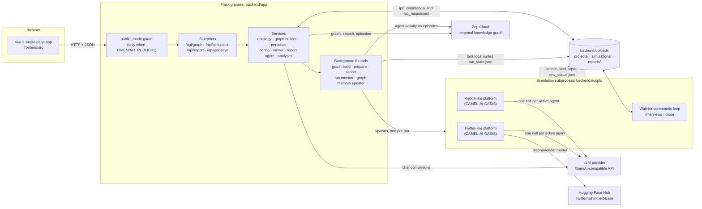
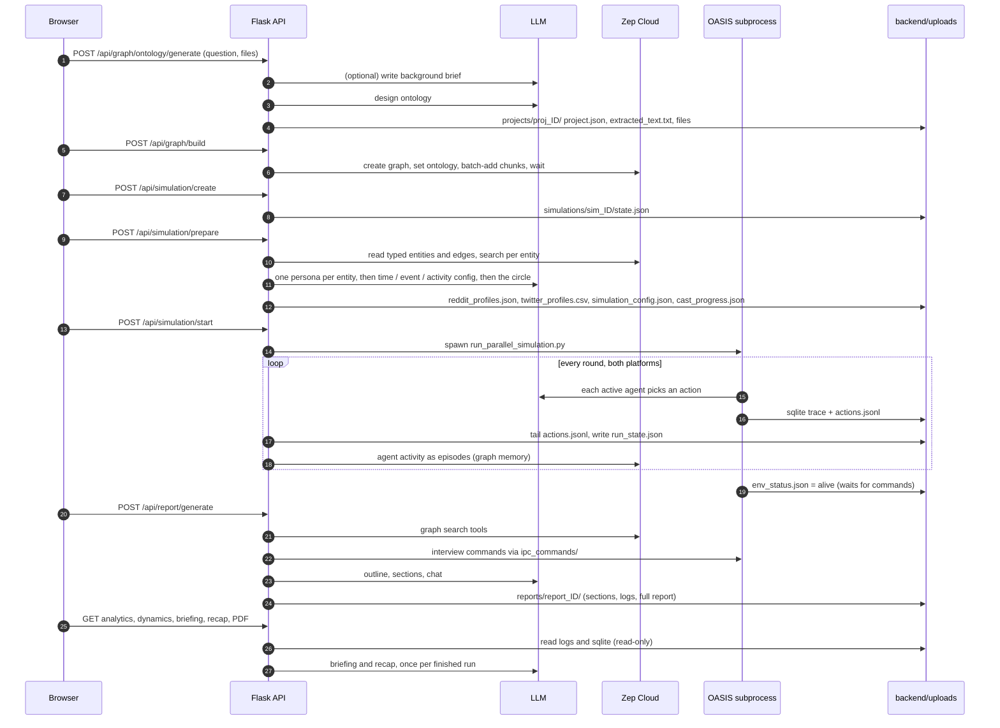

# Architecture

This page explains how Hivemind is put together: which processes run, how they talk to each
other, what is kept in memory and what is written to disk, which outside services it calls,
and why it is built this way.

For what each stage of a run does, see [PIPELINE.md](./PIPELINE.md). For the HTTP surface,
see [API.md](./API.md).

## Contents

- [The system at a glance](#the-system-at-a-glance)
- [Components](#components)
- [Process model](#process-model)
- [Data flow of one run](#data-flow-of-one-run)
- [What is stored on disk](#what-is-stored-on-disk)
- [What is kept in memory](#what-is-kept-in-memory)
- [External services](#external-services)
- [Concurrency and safety](#concurrency-and-safety)
- [Key design decisions](#key-design-decisions)

## The system at a glance



In one sentence: a Flask API holds the state of each run on disk, calls an LLM and Zep Cloud
for the expensive thinking, and hands the simulation itself to a separate Python process
running CAMEL-AI OASIS, which it watches through files.

## Components

| Component | Where | What it does |
| --- | --- | --- |
| Web app | `frontend/src` (Vue 3, Vite, vue-router, vue-i18n, D3, axios) | The five-step workflow, the Analytics page and the history list. Talks to the API with JSON. |
| App factory | `backend/app/__init__.py` | Builds the Flask app, enables CORS on `/api/*`, registers the four blueprints, `/health`, public mode, and (when `HIVEMIND_STATIC_DIR` is set) serves the built frontend. |
| Entry point | `backend/run.py` | Validates config (`LLM_API_KEY`, `ZEP_API_KEY` required; `ZEP_API_URL` rejected), then starts Werkzeug with `threaded=True`. |
| Config | `backend/app/config.py` | Loads the repo-root `.env` and exposes settings. See [CONFIGURATION.md](./CONFIGURATION.md). |
| Public mode | `backend/app/public_mode.py` | A `before_request` guard and `after_request` bookkeeping that turn the app into a capped public website. See [DEPLOYMENT.md](./DEPLOYMENT.md). |
| Graph API | `backend/app/api/graph.py` | Projects, ontology generation, graph build, task status, graph data. |
| Simulation API | `backend/app/api/simulation.py` | Entities, simulation create/prepare/start/stop, run status, actions, analytics, briefing, recap, PDF, interviews, environment control. |
| Report API | `backend/app/api/report.py` | Report generation, retrieval, sections, logs, chat. |
| God's Eye API | `backend/app/api/godseye.py` | Optional connector that turns live data from a local God's Eye View server into a seed document. |
| Ontology | `services/ontology_generator.py`, `utils/ontology.py` | LLM designs 10 entity types and up to 10 relationship types for the question. |
| Seed brief | `services/seed_brief.py` | When no evidence is given, the LLM writes a background brief that becomes the seed document. |
| Graph builder | `services/graph_builder.py`, `services/text_processor.py`, `utils/file_parser.py` | Extracts text, chunks it, creates the Zep graph, sets the ontology, submits chunks through Zep's Batch API, waits for ingestion. |
| Entity reader | `services/zep_entity_reader.py` | Reads all nodes and edges back from Zep and keeps the ones typed by the ontology. |
| Persona generator | `services/oasis_profile_generator.py` | One LLM call per entity writes the agent's bio and long persona. |
| Config generator | `services/simulation_config_generator.py` | LLM sets the simulated clock, the opening posts and each agent's activity. |
| Cast growth | `services/cast_growth.py`, `services/cast_circle.py`, `scripts/agent_spawner.py` | Adds the people around key actors at setup, and accounts that join mid-run. |
| Simulation manager | `services/simulation_manager.py` | Creates simulations and runs the prepare pipeline. |
| Simulation runner | `services/simulation_runner.py`, `services/simulation_ipc.py` | Starts and stops the subprocess, tails its logs into `run_state.json`, sends interview commands. |
| Simulation scripts | `backend/scripts/run_parallel_simulation.py` (+ `run_twitter_simulation.py`, `run_reddit_simulation.py`, `action_logger.py`, `oasis_patches.py`, `agent_spawner.py`) | The OASIS process: both platforms, the round loop, logging, IPC. |
| Graph memory | `services/zep_graph_memory_updater.py` | Turns logged agent actions into text episodes and writes them back into the Zep graph. |
| Report agent | `services/report_agent.py`, `services/zep_tools.py` | Plans and writes the long-form report with graph-search and interview tools, and answers chat. |
| Analytics layer | `services/simulation_analytics.py`, `trace_reader.py`, `run_dynamics.py`, `run_recap.py`, `run_briefing.py`, `run_cast.py`, `consensus_report.py` | Read-only measurement and write-ups. See [ANALYTICS.md](./ANALYTICS.md). |
| Models | `backend/app/models/project.py`, `models/task.py` | Project records on disk; in-memory task tracker for long jobs. |
| Utilities | `backend/app/utils/` | LLM client and provider compatibility, Zep client and retry policy, paging, locale, logging. |
| UI strings | `locales/` | `en.json`, `zh.json` and `languages.json`, shared by the frontend and the backend. |

## Process model

Hivemind runs as one Flask process plus one extra process per running simulation.

### The Flask process

- **Server.** `backend/run.py` calls `app.run(host, port, threaded=True)`. That is Werkzeug's
  development server with one thread per request. There is a single process and no worker
  pool. This matters, because several kinds of state live only in that process (see
  [What is kept in memory](#what-is-kept-in-memory)).
- **Long jobs run on daemon threads.** Three endpoints start work that takes minutes and
  return a task id at once:
  - `POST /api/graph/build` starts the graph build thread.
  - `POST /api/simulation/prepare` starts the prepare thread (personas and config).
  - `POST /api/report/generate` starts the report thread.

  Each thread reports progress into `TaskManager` (`models/task.py`), which the frontend
  polls. The request's UI language is captured before the thread starts and set on the
  thread (`set_locale`), so progress messages and LLM output follow the user's language.
- **One monitor thread per running simulation.** `SimulationRunner._monitor_simulation`
  wakes every 2 seconds, reads new lines from `twitter/actions.jsonl` and
  `reddit/actions.jsonl` from where it last stopped, updates the run state and saves
  `run_state.json`.
- **One graph-memory worker per running simulation**, when memory write-back is on. It
  batches actions per platform and sends them to Zep (see [PIPELINE.md](./PIPELINE.md#memory-write-back)).
- **Shutdown cleanup.** `SimulationRunner.register_cleanup()` installs SIGINT, SIGTERM and
  SIGHUP handlers plus an `atexit` hook that stop every simulation process and drain graph
  memory, so stopping the server does not leave orphaned OASIS processes.

### The simulation subprocess

`SimulationRunner.start_simulation` launches:

```
<python> backend/scripts/run_parallel_simulation.py --config <sim_dir>/simulation_config.json [--max-rounds N]
```

with `cwd` set to the simulation folder, stdout and stderr sent to `simulation.log`, and
`start_new_session=True` so the whole process group can be killed with one signal.
`PYTHONUTF8=1` and `PYTHONIOENCODING=utf-8` are set so OASIS reads files as UTF-8 on every
platform. The script loads the repo-root `.env` itself, so it sees the same LLM settings.

Inside, one asyncio loop runs both platforms concurrently (`asyncio.gather`). Each platform
is an OASIS environment with its own SQLite database. The UI always starts the `parallel`
script. The single-platform scripts still exist and can be chosen through the API, but they
do not include cast growth, the busy-hour start or the environment lifetime.

### The kept-alive environment

After the last round the subprocess does not exit. It enters a wait-for-commands loop:

1. It writes `env_status.json` with `"status": "alive"`.
2. Every 0.5 seconds it looks in `ipc_commands/` for a command file.
3. It runs the command (`interview`, `batch_interview` or `close_env`) and writes the
   answer to `ipc_responses/<command_id>.json`, then deletes the command file.

On the Flask side, `SimulationIPCClient` writes the command file and polls for the response
every 0.5 seconds until a timeout (60 s for one interview, 120 s for a batch by default).
`check_env_alive` simply reads `env_status.json`.

The environment closes when it receives `close_env`, when the process is signalled, or when
`HIVEMIND_ENV_LIFETIME_MINUTES` has passed (unset or 0 means never; the public Docker image
sets 20). When it closes, the monitor thread sees the process exit and publishes the final
run status.

Why keep it alive: an OASIS agent's memory of the run is its in-process conversation
history. Keeping the process alive is what lets the report agent and the user interview the
same agents, with everything they saw and said, after the rounds end.

## Data flow of one run



## What is stored on disk

Everything a run produces lives under `backend/uploads/` (the Railway volume is mounted
there). There is no database server. Each record is a JSON file, a JSONL log or an SQLite
file written by OASIS.

```
backend/uploads/
├── public_quota.json                  public mode only: daily counters and which runs were started here
├── .hf/                               Docker image only: Hugging Face cache (HF_HOME), holds twhin-bert
├── projects/
│   └── proj_<12 hex>/
│       ├── project.json               the project record (see below)
│       ├── extracted_text.txt         all seed text joined, with "=== <filename> ===" headers
│       └── files/
│           └── <8 hex>.<ext>          each upload, pasted text or generated brief, under a random name
├── simulations/
│   └── sim_<12 hex>/
│       ├── state.json                 simulation record: project, graph, status, counts, flags
│       ├── cast_progress.json         planned cast and which personas are written (for the cast tree)
│       ├── reddit_profiles.json       one profile per agent (JSON, OASIS Reddit format)
│       ├── twitter_profiles.csv       the same agents (CSV, OASIS Twitter format)
│       ├── simulation_config.json     time, events, per-agent activity, platform settings
│       ├── cast_growth.json           cast-growth settings in force and who joined mid-run
│       ├── run_state.json             live run status, written by the monitor thread
│       ├── simulation.log             the subprocess's stdout and stderr
│       ├── twitter/actions.jsonl      every Twitter-side action and round event, one JSON per line
│       ├── reddit/actions.jsonl       the same for the Reddit side
│       ├── twitter_simulation.db      OASIS SQLite: user, post, comment, like, dislike, follow, mute, trace, rec, …
│       ├── reddit_simulation.db       the same for the Reddit side
│       ├── env_status.json            "alive" or "stopped", written by the subprocess
│       ├── ipc_commands/              command files waiting to be run
│       ├── ipc_responses/             answers to commands
│       ├── briefing.json              cached AI briefing, keyed to a fingerprint of the facts
│       └── recap.json                 cached AI "What happened" story, keyed to the action log
└── reports/
    └── report_<12 hex>/
        ├── meta.json                  report record: ids, status, outline, full markdown
        ├── outline.json               title, summary, section titles
        ├── progress.json              status, percent, current and finished sections
        ├── section_01.md …            each section as soon as it is written
        ├── full_report.md             the assembled report
        ├── agent_log.jsonl            structured log of planning, tool calls and LLM replies
        └── console_log.txt            plain-text log of the same run
```

Notes on the main files:

- **`project.json`** holds `project_id`, `name`, `status` (`created`, `ontology_generated`,
  `graph_building`, `graph_completed`, `failed`), the `files` list (original names and
  sizes), `total_text_length`, the `ontology` (`entity_types`, `edge_types`),
  `analysis_summary`, `graph_id`, `graph_build_task_id`, `zep_batch_id`,
  `zep_batch_operation_id`, `simulation_requirement` (the question), `chunk_size`,
  `chunk_overlap` and `error`.
- **`state.json`** holds the simulation's `status` (`created`, `preparing`, `ready`,
  `running`, `stopping`, `paused`, `stopped`, `completed`, `failed`), `entities_count`,
  `profiles_count`, `entity_types`, `profiles_generated`, `config_generated`,
  `config_reasoning`, which platforms are enabled, timestamps and `error`.
- **`run_state.json`** holds `runner_status` (`idle`, `starting`, `running`, `paused`,
  `stopping`, `stopped`, `completed`, `failed`), `current_round`, `total_rounds`, simulated
  hours, per-platform rounds, counts, `*_running` and `*_completed` flags,
  `ready_for_report`, `process_pid`, timestamps, `error`, and the 50 most recent actions.
- **`actions.jsonl`** has two kinds of line. Agent actions carry `round`, `timestamp`,
  `agent_id`, `agent_name`, `action_type`, `action_args`, `result` and `success`. Events carry
  `event_type`: `simulation_start` (`platform`, `total_rounds`, `agents_count`),
  `round_start` (`round`, `simulated_hour`), `round_end` (`round`, `actions_count`) and
  `simulation_end` (`total_rounds`, `total_actions`). Round 0 is the opening posts.
- **The SQLite files** are OASIS's own databases. The `trace` table records every action an
  agent took, including feed refreshes and interviews, and is the source for cascade trees
  and blind-turn counts.

Files are replaced atomically (write to `*.tmp`, then `os.replace`) wherever a reader may be
looking at the same time: the public quota, the briefing and recap caches, the cast files
the subprocess updates mid-run, and the cast progress file.

Gitignore: `backend/uploads/`, `backend/logs/`, `backend/log/` and `*.log` are ignored, so
local runs never reach the repository. `.dockerignore` excludes them from the image too.

## What is kept in memory

Some state lives only inside the Flask process. A restart loses it, and the code is written
to recover from disk where it can.

| In memory | Where | After a restart |
| --- | --- | --- |
| Long-job tasks (graph build, prepare, report) | `TaskManager` singleton | Lost. The status endpoints fall back to disk: prepare status checks the simulation's files, report status checks for a completed report, and a graph build whose task vanished can resume a persisted Zep batch. |
| Running simulation processes and monitor threads | `SimulationRunner._processes`, `_monitor_threads` | The shutdown handler stops each live run through the normal stop path first (it ends as `stopped`). A kept-alive environment does not survive a restart, so interviews on that run stop working. |
| Graph-memory updaters | `ZepGraphMemoryManager` | Drained on shutdown where possible. |
| Graph locks and report read leases | `utils/zep_lifecycle.py` | Lost (they only protect work that was also lost). |
| Run-state cache | `SimulationRunner._run_states` | Rebuilt from `run_state.json` on demand. |

This is why Hivemind runs as a single process. More workers would each have their own copy
of these registries, and two of them could start the same simulation.

## External services

| Service | Used for | Called from | Notes |
| --- | --- | --- | --- |
| **LLM provider** (any OpenAI-compatible Chat Completions API) | Seed brief, ontology, personas, config, the circle, every agent action, joiners, report agent, chat, interviews, briefing, recap | `utils/llm_client.py` (Flask side), CAMEL `ModelFactory` (subprocess), `agent_spawner.py` | The defaults in `.env.example` point at Anthropic's OpenAI-compatible endpoint with `claude-haiku-5-5`. `utils/openai_chat_compat.py` adapts requests for Claude 5 and GPT-5 models. An optional second endpoint (`LLM_BOOST_*`) can serve the Reddit side. |
| **Zep Cloud** | The temporal knowledge graph: create, ontology, ingestion of seed text, node and edge reads, semantic search, and episodes written back from the run | `utils/zep.py` (shared client), `graph_builder.py`, `zep_entity_reader.py`, `oasis_profile_generator.py`, `zep_graph_memory_updater.py`, `zep_tools.py` | Cloud only: `ZEP_API_URL` is rejected so the SDK cannot be pointed elsewhere. HTTP timeout 60 s. Ingestion waits up to 600 s. Reads retry with backoff; writes do not (see below). |
| **Hugging Face Hub** | Downloads `Twitter/twhin-bert-base`, which the OASIS Twitter recommender uses to embed posts and profiles | OASIS (`oasis/social_platform/recsys.py`) | Downloaded once and cached (`HF_HOME`; on Railway it sits on the volume). |
| **God's Eye View** (optional, local) | Live situational data (headlines, hazards, weather, aggregate air and sea traffic) as a seed document | `services/godseye_client.py`, `services/godseye_seed.py` | Off on the public site. Tools that identify or track individual people, aircraft or vessels, and camera or licence-plate tools, are refused by the client. |
| **Google Fonts** | Web fonts in the browser | `frontend/index.html` | Browser only. |

## Concurrency and safety

The code expects requests, background threads and the subprocess to touch the same run at
the same time. The main guards:

- **Per-project build lock** (`api/graph.py`). Building, resetting and deleting a project
  are serialised, so two build requests cannot create two graphs.
- **Per-graph lifecycle lock** (`utils/zep_lifecycle.py`, a re-entrant lock keyed by graph
  id). Deleting or resetting a graph, starting a run that writes graph memory, and starting
  a report all take it, so none of them can slip between another's check and its Zep call.
- **Report read leases.** A report registers itself as a reader of its graph for as long
  as it runs. Deleting the graph, or starting a run that would write into it, is refused
  while a report is reading.
- **Per-simulation finalisation lock** (`SimulationRunner._finalization_lock`). Natural
  completion, manual stop and graph-memory drain all publish the final status under it, so
  only one path decides the outcome.
- **Ingestion barrier.** While graph memory is still being written, the run is reported as
  `stopping`, not `completed`, and report generation is refused. A report never reads a
  half-written graph.
- **Idempotent Zep writes.** Creating a graph and adding a batch are not retried blindly.
  The graph id is generated locally and saved before the create call. Each batch carries a
  deterministic `hivemind_operation_id` (a SHA-256 of the graph id and the chunk text), saved
  before the call, so a lost reply can be reconciled by listing batches instead of
  duplicating the graph's contents. Reads are retried up to 3 times with exponential backoff
  that respects `Retry-After`.
- **Validated LLM JSON.** `LLMClient.chat_json` asks for JSON mode, falls back to prompt-only
  JSON when a provider rejects `response_format`, refuses truncated output
  (`finish_reason == "length"`) instead of repairing it, and retries once without a token cap.

## Key design decisions

**1. OASIS runs in its own process.**
OASIS pulls in PyTorch, transformers and CAMEL, runs its own asyncio loop, and can use
gigabytes of memory on long runs. Running it as a subprocess keeps the API responsive,
isolates crashes (a failed run marks itself `failed`, the server carries on), and lets a stop
request kill the whole process group. The Flask app never imports OASIS.

**2. Inter-process communication goes through files.**
Commands and responses are JSON files in the run folder; status is `env_status.json`;
progress is the append-only `actions.jsonl`. This needs no broker, survives a browser
refresh, and every message can be inspected after the fact. The costs are polling latency
(0.5 s for commands, 2 s for the monitor) and that it only works on one machine.

**3. The environment stays alive after the last round.**
Agents remember the run only inside the process. Keeping it alive lets the report agent's
`interview_agents` tool and the Interaction page question the real agents. The run is marked
`ready_for_report` as soon as every platform has logged `simulation_end` and graph memory has
drained, so the user does not have to close the environment to get a report. On the public
site a lifetime cap stops finished runs from holding memory forever.

**4. Measurement never changes the prediction.**
Analytics, run dynamics, the cast tree, the recap and the briefing only read files a run
already wrote. None of them feed back into the simulation, the graph or the report agent.
Adding a chart can never change what a run predicts.

**5. Facts are computed; the model only interprets them.**
The briefing and the recap are built in two layers. A pure Python function turns the logs
into facts (counts, groups, verbatim posts). The LLM receives only those facts and is told
not to invent names or numbers. Its JSON is validated and any gap is filled from a template
that writes the same shape without a model, so a write-up always exists, even while a run is
live or the provider is down. Results are cached and keyed to the facts, so each finished run
costs one call per write-up.

**6. OASIS is patched at runtime, not forked.**
`camel-oasis` is pinned at 0.2.5. `scripts/oasis_patches.py` fixes three defects when a run
starts (a quote-post crash that blinded many feeds, silent feed errors, and an
all-at-once embedding pass that ran out of memory). Each patch first checks the library's
source is what it expects and does nothing otherwise, and the run log records which patches
were applied. Upgrading OASIS cannot be broken by a stale patch.

**7. Added voices are always labelled.**
The cast starts as whoever the knowledge graph names. Hivemind adds people around key
actors and lets newcomers join mid-run, because real conversations widen. Every added account
is named by role (never a made-up personal name), carries an `origin` (`circle` or `joined`),
and each kind is capped at a quarter of the evidence cast. The briefing tells the reader how
many voices were added and what share of the writing they did.

**8. Rounds are capped by default.**
Every active agent makes a model call every round on each platform. The LLM-designed clock
often asks for 72 to 168 rounds. `OASIS_DEFAULT_MAX_ROUNDS` (10) is applied when the caller
sets no limit, and on the public site it is a hard ceiling.

**9. One container serves both the API and the app.**
In production, Flask serves the built Vue app from `HIVEMIND_STATIC_DIR` and answers `/api`
on the same port. One service, one origin, no CORS setup, and the frontend is built with
`VITE_API_BASE_URL=/`.

**10. Public mode is one guard in front of everything.**
Spend limits and read-only history are enforced in `public_mode.py` as a `before_request`
hook, not inside each endpoint. The endpoints stay the same locally and publicly, the
whole policy can be read in one file, and usage is persisted in `public_quota.json` so a
restart does not reset it.

**11. Provider quirks are handled in one place.**
Claude 5 models on Anthropic's OpenAI-compatible endpoint reject `temperature` and accept
only `json_schema` response formats. `utils/openai_chat_compat.py` detects the model family
and adjusts the request, so the rest of the code calls one function regardless of provider.
