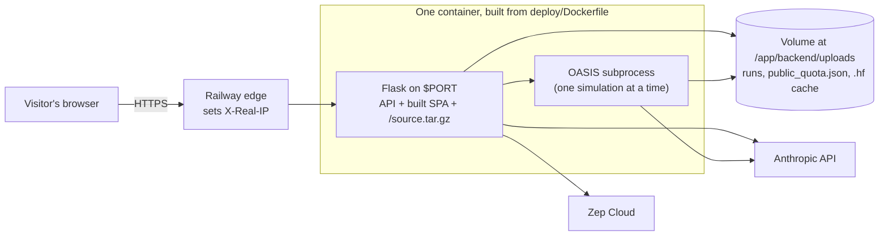

# Deployment: the public site

Hivemind runs as a public website at
**https://hivemind-production-25f13fa5.up.railway.app**. Anyone can start a simulation,
browse earlier runs, read their briefings and reports, and talk to the report agent and the
simulated people. It runs on the owner's Anthropic and Zep keys, so public mode adds spend and
safety limits.

This page covers the policy, how it is enforced, the Docker image, the Railway setup,
persistence, loading history, the AGPL source offer, cost control, an operations checklist and
the known caveats.

## Contents

- [Overview](#overview)
- [Public mode policy](#public-mode-policy)
- [How the guard works](#how-the-guard-works)
- [Telling visitors apart](#telling-visitors-apart)
- [The Docker image](#the-docker-image)
- [Railway setup](#railway-setup)
- [Persistence](#persistence)
- [Loading history](#loading-history)
- [AGPL source offer](#agpl-source-offer)
- [Cost control](#cost-control)
- [Operations checklist](#operations-checklist)
- [Known caveats](#known-caveats)
- [Other ways to run it](#other-ways-to-run-it)

## Overview



- **One Railway service** (`hivemind` in the Railway project `hivemind`) runs one container.
- Flask serves the API, the built frontend and the source archive on Railway's `$PORT`.
- A **volume** (`hivemind-volume`) is mounted at `/app/backend/uploads`, so runs, the usage
  file and the model cache survive redeploys.
- Keys are Railway **service variables**, never files.

## Public mode policy

`HIVEMIND_PUBLIC=1` (set in the image) turns on `backend/app/public_mode.py`.

| Area | Rule |
| --- | --- |
| **New runs** | At most `HIVEMIND_RUNS_PER_DAY` (5) per UTC day for everyone together, and `HIVEMIND_RUNS_PER_VISITOR` (1) per visitor per UTC day. A new run is counted when `POST /api/graph/ontology/generate` is accepted. |
| **One simulation at a time** | A new run, or a simulation start, is refused (429) while any simulation process is active. A run whose rounds are all played is not counted, even while its agents are kept alive for interviews, so the next visitor can start straight away. |
| **Rounds** | Capped at `OASIS_DEFAULT_MAX_ROUNDS` (10) whatever the request asks. With the usual 60 simulated minutes per round, that is about 10 simulated hours. The setup page shows the cap and how much of the planned schedule it covers, instead of a round picker. |
| **Paid steps** | Graph build, simulation create, setup and start work only on runs started on this site, and each only once. One simulation per project. |
| **Earlier runs** | Public and read-only. Anyone can open them. Opening an earlier run's setup page returns its finished setup without re-preparing it. Step 3 shows its recorded actions. |
| **Reports** | `POST /api/report/generate` is accepted once per simulation, including an earlier run that has no report yet. |
| **Chat and interviews** | `HIVEMIND_CHATS_PER_VISITOR` (20) per visitor and `HIVEMIND_CHATS_PER_DAY` (150) in total, per UTC day. Covers `/api/report/chat`, `/api/simulation/interview` and `/api/simulation/interview/batch`; a batch costs one per person asked. |
| **Briefing and recap** | Written by the model once a run has finished (409 before that), at most 3 times per run for each, and stored. Rewriting on demand is off and the Rewrite buttons are hidden. Earlier runs show their stored briefing and story. |
| **Forced regeneration** | Any `POST` with `"force": true` or `"force_regenerate": true` is refused, except `POST /api/simulation/start` (the run page always sends `force`, and a simulation can still start only once). |
| **Turned off** | Every `DELETE`; project reset; `stop`, `close-env`, `generate-profiles`, `interview/all`; the report tool endpoints (`/api/report/tools/*`); script downloads; the whole God's Eye View connector. |
| **Uploads** | Request size limit 20 MB (50 MB locally). |
| **Kept-alive agents** | Close `HIVEMIND_ENV_LIFETIME_MINUTES` (20) after the last round. After that the Interaction page says the run's people are offline and disables interviews and surveys; chat with the report agent still works. |
| **Admin** | `/api/admin/import`, `/api/admin/quota/reset` and `/api/admin/headers` need the `X-Admin-Token` header. |

The home page tells visitors how many free runs are left today, that runs are public and
appear in the history list, and that each run is capped at 10 rounds. Before a visitor presses
Run, it also says if their run for today is used, if the day's runs are gone, or if another
simulation is running, and disables Run. If a start is refused anyway, the run page and Step 3
show the server's reason (Step 3 with a Try again button). Everyone's runs appear in the
history.

Denials are JSON: `{"success": false, "error": "<plain sentence>", "public_limit": true}` with
403 (not allowed), 429 (limit reached or busy), 409 (not finished yet) or 404 (unknown run).

## How the guard works

`public_mode.register(app)` installs:

- `_check` as a `before_request` hook. It ignores non-`/api/` paths and `/api/admin/*` (those
  check the token themselves). In order, it refuses every `DELETE`, then anything on the
  blocked list, then (for `POST`s) any forced regeneration, and then applies the per-endpoint
  rules above under a lock.
- `_record` as an `after_request` hook. When a new run's ontology request succeeds it records
  the new `project_id` and the visitor; when a simulation is created for such a project it
  records the `simulation_id`. Later steps check these records, which is how "runs started on
  this site" is known. Bookkeeping errors are logged, never returned.
- The routes `/api/public/status`, `/source.tar.gz`, `/api/admin/headers`,
  `/api/admin/quota/reset` and `/api/admin/import`.

Usage lives in `uploads/public_quota.json`, written atomically:

```json
{
  "days":        { "2026-11-19": { "runs": 3, "chats": 41, "runs_by_ip": {"<visitor hash>": 1}, "chats_by_ip": {"<visitor hash>": 12} } },
  "projects":    { "proj_…": { "visitor": "<visitor hash>", "created": "2026-11-19", "built": true, "simulations": ["sim_…"] } },
  "simulations": { "sim_…": { "project_id": "proj_…", "started": true, "reported": true, "writes": {"briefing": 1, "recap": 1} } }
}
```

Visitors are stored as a SHA-256 hash of their address (16 hex characters), never the address
itself. Only the last 7 days of daily counters are kept. Because the file is on the volume, a restart
or a redeploy does not reset anyone's allowance.

`GET /api/public/status` shows what is left: `runs_today`, `runs_per_day`,
`runs_left_today`, `visitor_runs_left_today`, `busy`, `max_rounds` and `visitor` (a short,
non-reversible hash of the visitor's IP, for checking that visitors are told apart).

## Telling visitors apart

`client_ip()` uses the `X-Real-IP` header. Railway's edge discards any `X-Real-IP` or
`X-Forwarded-For` a client sends and rebuilds them: `X-Real-IP` is the visitor and
`X-Forwarded-For` is `<visitor>, <edge node>`. This was checked on 2026-11-19 by sending
spoofed headers. So `X-Real-IP` cannot be forged from outside, and the last
`X-Forwarded-For` entry must not be used, because it is the edge node that many visitors
share (using it would put everyone on one allowance). If `X-Real-IP` is absent the first
`X-Forwarded-For` entry is used, then the socket address.

`GET /api/admin/headers` (token required) shows the forwarding headers the edge actually sent
and the IP that was chosen, for re-checking after any platform change.

## The Docker image

`deploy/Dockerfile`, two stages, built from the repository root:

1. **Web stage** (`node:22-slim`): copies `locales/` and `frontend/`, runs `npm ci` and
   `npm run build` with `VITE_API_BASE_URL=/` (same-origin API calls) and `VITE_PUBLIC=1`
   (the public-site touches).
2. **Runtime stage** (`python:3.12-slim` with `uv` 0.9.26):
   - Exports the locked dependencies from `backend/uv.lock`, removes `torch`, `triton` and
     the `nvidia-*` packages from the list, installs **CPU-only torch** at the locked version
     from PyTorch's CPU index, then installs everything else exactly as locked. The Linux
     torch wheel in the lockfile would pull about 3 GB of CUDA libraries a CPU container never
     uses.
   - Copies the repository and the built `frontend/dist`.
   - Builds `/opt/hivemind-source.tar.gz` from the build context, excluding `frontend/dist`,
     `backend/.venv`, `backend/uploads` and `node_modules`.
   - Sets `HIVEMIND_PUBLIC=1`, `HIVEMIND_STATIC_DIR=/app/frontend/dist`,
     `HIVEMIND_SOURCE_ARCHIVE=/opt/hivemind-source.tar.gz`,
     `HIVEMIND_ENV_LIFETIME_MINUTES=45`, `FLASK_HOST=0.0.0.0` and
     `HF_HOME=/app/backend/uploads/.hf`.
   - Runs `.venv/bin/python run.py` from `/app/backend`.

`.dockerignore` keeps `.env` (and `.env.*` except `.env.example`), `node_modules`, the virtual
environment, `backend/uploads`, logs, `linkedin/`, `.claude` and `.playwright-mcp` out of the
build context, so they are neither in the image nor in the source archive.

## Railway setup

| Setting | Value |
| --- | --- |
| Builder | Dockerfile |
| Dockerfile | `deploy/Dockerfile`, selected by the service variable `RAILWAY_DOCKERFILE_PATH=deploy/Dockerfile`. `railway.json` also names it under `build.dockerfilePath`, but Railway ignored that for this service, so the variable is what makes it work. Without it Railway builds the root `Dockerfile`, which is the local development image. |
| Health check | `GET /health`, 120 s timeout (`railway.json`) |
| Restart policy | on failure, up to 5 retries (`railway.json`) |
| Volume | mounted at `/app/backend/uploads` |
| Port | Railway's `$PORT`, read by `run.py` |

**Service variables:**

| Variable | Value |
| --- | --- |
| `LLM_API_KEY` | the Anthropic key |
| `LLM_BASE_URL` | `https://api.anthropic.com/v1/` |
| `LLM_MODEL_NAME` | `claude-haiku-5-5` |
| `ZEP_API_KEY` | the Zep Cloud key |
| `HIVEMIND_ADMIN_TOKEN` | a long random string |
| `RAILWAY_DOCKERFILE_PATH` | `deploy/Dockerfile` |
| optional | `HIVEMIND_RUNS_PER_DAY`, `HIVEMIND_RUNS_PER_VISITOR`, `HIVEMIND_CHATS_PER_VISITOR`, `HIVEMIND_CHATS_PER_DAY`, `OASIS_DEFAULT_MAX_ROUNDS`, `HIVEMIND_ENV_LIFETIME_MINUTES`, `HIVEMIND_EMBED_BATCH` |

The image already sets the other public-mode variables. All of them are described in
[CONFIGURATION.md](./CONFIGURATION.md).

**Deploying.** From the repository root:

```bash
railway up --detach -s hivemind
```

`railway up` uploads the working directory and honours `.gitignore`, so `.env`, local runs and
`linkedin/` stay on the laptop. Watch the build and deploy logs in the Railway dashboard or with
`railway logs`.

## Persistence

Everything on the volume survives redeploys and restarts:

| Path on the volume | Content |
| --- | --- |
| `projects/`, `simulations/`, `reports/` | every run, as described in [ARCHITECTURE.md](./ARCHITECTURE.md#what-is-stored-on-disk) |
| `public_quota.json` | daily usage and which runs were started on the site |
| `.hf/` | the Hugging Face cache, so `Twitter/twhin-bert-base` is downloaded once |

What does not survive a restart: in-memory task progress (the status endpoints recover from
files), any simulation that was running (the shutdown handler stops it), and kept-alive agents
(interviews on that run end).

## Loading history

Runs made locally can be copied onto the site so it opens with a populated history. The owner
packs the run folders and posts them to the admin import endpoint:

```bash
cd backend/uploads
tar czf /tmp/hivemind-runs.tar.gz projects simulations reports
curl -H "X-Admin-Token: $HIVEMIND_ADMIN_TOKEN" \
     -F "archive=@/tmp/hivemind-runs.tar.gz" \
     https://hivemind-production-25f13fa5.up.railway.app/api/admin/import
```

- Only members whose paths start with `projects/`, `simulations/` or `reports/` are unpacked,
  using tarfile's `data` filter (no absolute paths, no links outside the folder).
- Files with the same path are overwritten.
- The cached run states are cleared so the imported `run_state.json` files are read fresh.
- The response is `{"imported": <number of members>}`. A wrong or missing token returns 404.
- Imported runs are read-only like any earlier run. Their agents are not alive, so interviews
  are unavailable; chat with the report agent works.
- **Everything imported becomes public**, including the seed files under `projects/*/files/`.
  Check a run's content before importing it.

A copy of the admin token is kept outside the repository, never in it.

## AGPL source offer

Hivemind is licensed under the AGPL-3.0. Section 13 requires that users of a modified version
running as a network service are offered its source. The image builds an archive of exactly
the source it was built from and serves it at `/source.tar.gz`; the header's "Source" link
points there on the public site (locally the header links to GitHub). The archive excludes
build outputs, the virtual environment, run data and `node_modules`, and, through
`.dockerignore`, secrets and local-only material.

## Cost control

Every limit below exists because the site spends the owner's money:

- **Few runs.** 5 a day in total, 1 per visitor, one at a time.
- **Short runs.** 10 rounds at most. Round count is the main multiplier of model calls.
- **A cheap model for the crowd.** `claude-haiku-5-5` plays every participant.
- **No repeat spending.** Every paid step works once per run; forced regeneration is off;
  briefings and recaps are written once (at most 3 times) and cached.
- **Metered conversation.** 20 chats or interviews per visitor and 150 in total per day.
- **Freed memory.** Kept-alive agents close after 45 minutes (long enough for the report agent's interviews and a visitor's own questions). The recommender embeds in small
  batches, so a long run does not exhaust the container.
- **No open-ended endpoints.** Ask-everyone interviews, debug tools and the external
  connector are off.

Set spend limits with the providers as well (Anthropic and Zep consoles, Railway usage
limits), because the app's own counters reset each UTC day.

## Operations checklist

Before a demo or after a deploy:

1. `GET /health` returns `{"status": "ok"}`.
2. `GET /api/public/status` shows `public: true`, the expected `runs_left_today` and
   `busy: false`.
3. The home page loads, shows the free-runs note, and the history list shows the imported runs.
4. Open an earlier run: Analytics loads with its stored briefing and story; the PDF downloads;
   the report opens; chat with the report agent answers.
5. `/source.tar.gz` downloads.
6. The Railway volume has free space (runs, SQLite files and the model cache all live there).
7. Anthropic and Zep usage are within plan.

During a live run: watch the Railway logs for `[oasis-patch]` lines at start (all three
patches should say "applied"), for `[feed-error]` lines, and for memory use.

To give today's runs and chats back (for example after your own test run), call the owner-only
reset endpoint. It clears today's counters and keeps the record of which runs were started on
the site:

```bash
curl -X POST -H "X-Admin-Token: $HIVEMIND_ADMIN_TOKEN" \
     https://hivemind-production-25f13fa5.up.railway.app/api/admin/quota/reset
```

## Known caveats

- **Development server.** Flask runs on Werkzeug's development server (`app.run`, threaded), in
  a single process. It is enough for a capped demo site; it is not a production WSGI setup. More
  processes would break the in-memory locks and registries (see
  [ARCHITECTURE.md](./ARCHITECTURE.md#what-is-kept-in-memory)).
- **Restarts end live work.** A redeploy stops any running simulation and closes kept-alive
  agents.
- **Short simulated time.** 10 rounds is about 10 simulated hours. The site shows early
  reactions, not how a story plays out over days.
- **The recommender's weights.** The Twitter-side recommender loads `twhin-bert-base` with
  `AutoModel` and uses its pooler output; the pooler weights are randomly initialised in each
  run, so post similarity, and therefore who sees what, varies between runs. See
  [LIMITATIONS.md](./LIMITATIONS.md).
- **Zep free tier.** Graph ingestion and memory episodes count against the Zep plan. A busy day
  can hit its limits.
- **`railway.json` deprecation.** Railway's config-as-code file is deprecated after
  2026-12-01. The build already depends on the `RAILWAY_DOCKERFILE_PATH` variable; move the
  health check and restart policy into the service settings before then.
- **A failed run still counts.** A visitor's allowance is used when the run starts, even if a
  later step fails.
- **It is a simulation.** The output is a simulation of opinion, not a prediction of real
  outcomes and not financial advice. See [LIMITATIONS.md](./LIMITATIONS.md).

## Other ways to run it

- **Locally:** `./hivemind.sh`. See [DEVELOPMENT.md](./DEVELOPMENT.md).
- **Docker Compose:** `docker compose up --build` uses the root `Dockerfile`, a development
  image (`python:3.11` with Node, running `npm run dev`, frontend on 3000 and API on 5001),
  reads `.env`, and mounts `backend/uploads`. It does not use public mode.
- **Continuous integration:** `.github/workflows/tests.yml` runs the backend tests (with
  CPU-only torch, as in the image) and the frontend build on every push and pull request.
- **Container registry:** `.github/workflows/docker-image.yml` builds the root `Dockerfile`
  for `linux/amd64` and `linux/arm64` and publishes `ghcr.io/<owner>/hivemind` when a tag is
  pushed (or on a manual run with publishing enabled from the default branch).
- **Your own public deployment:** build `deploy/Dockerfile`, mount a volume at
  `/app/backend/uploads`, set the variables above, and check that your platform's
  `X-Real-IP` cannot be spoofed before relying on per-visitor limits.
