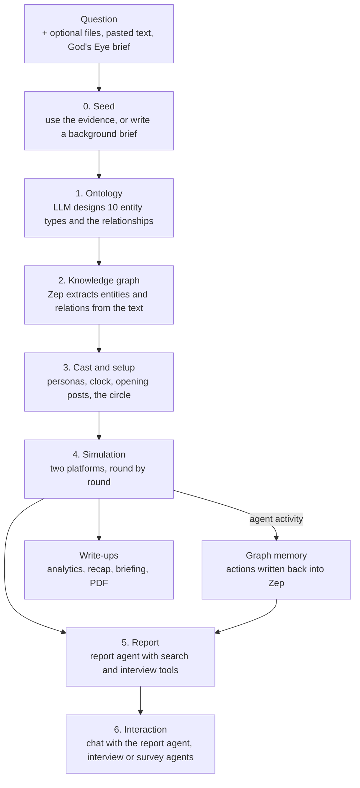

# The pipeline, stage by stage

A Hivemind run goes through seven stages. This page explains each one: the endpoints that
drive it, the code that does the work, what the model is asked to do, what is written to
disk, and what makes it slow or expensive.



In the browser these map to five steps: Step 1 covers stages 0 to 2, Step 2 is stage 3,
Step 3 is stage 4, Step 4 is stage 5 and Step 5 is stage 6. The Analytics page sits beside
Step 3.

Throughout, "the LLM" means the model set by `LLM_MODEL_NAME` on the endpoint
`LLM_BASE_URL` (by default Claude Haiku 5.5 through Anthropic's OpenAI-compatible API).
Every prompt ends with a language instruction from `locales/languages.json`, so output
follows the UI language (English by default).

## Contents

- [0. Seed](#0-seed)
- [1. Ontology](#1-ontology)
- [2. Knowledge graph](#2-knowledge-graph)
- [3. Cast and setup](#3-cast-and-setup)
- [4. Simulation](#4-simulation)
- [Memory write-back](#memory-write-back)
- [5. Report](#5-report)
- [6. Interaction](#6-interaction)
- [Write-ups](#write-ups)
- [Where the time and money go](#where-the-time-and-money-go)

## 0. Seed

**Endpoint:** part of `POST /api/graph/ontology/generate` (multipart form).
**Code:** `api/graph.py::generate_ontology`, `services/seed_brief.py`, `utils/file_parser.py`,
`services/text_processor.py`, `services/godseye_seed.py` (optional).

Only the question (`simulation_requirement`) is required. Evidence can arrive in three ways,
in any combination:

| Source | How it arrives | Saved as |
| --- | --- | --- |
| Uploaded files | `files` (PDF, Markdown or text; extensions `pdf`, `md`, `markdown`, `txt`) | `files/<8 hex>.<ext>` |
| Pasted text | `seed_text` form field | `pasted-notes.txt` |
| God's Eye View brief | The Home page's connector builds a Markdown brief and adds it as a file | a normal upload |

Text extraction uses PyMuPDF for PDFs and `charset-normalizer`, then `chardet`, to detect
the encoding of text files. `TextProcessor.preprocess_text` normalises line endings, trims
each line and collapses runs of blank lines. All texts are joined into
`extracted_text.txt`, each under a `=== <filename> ===` header.

If files were sent but none could be read, the request fails with 400 and the project is
deleted, rather than silently running on a generated brief.

**Question-only runs.** If there is no evidence at all, `write_seed_brief` asks the LLM for
a background brief:

- Sections: Situation; Who has a stake (15 to 25 named actors under six sub-headings:
  companies and executives, government and regulators, investors and analysts, media,
  experts and institutions, public voices); How they relate; Timeline; Open questions.
- Rules: use real, specific names; say "reportedly" when unsure; never invent quotes,
  figures or dates; keep the scenario premise apart from established fact; 600 to 1,000
  words. Today's date is included in the prompt.
- Temperature 0.4, up to 4,096 tokens. A reply shorter than 200 characters is an error.
- The saved brief (`hivemind-brief.md`) starts with a note that it was written by the model
  from general knowledge and may be out of date. The UI repeats this.

The response's `seed_source` is `documents`, `pasted` or `brief`.

## 1. Ontology

**Endpoint:** `POST /api/graph/ontology/generate` (same request as stage 0).
**Code:** `services/ontology_generator.py`, `utils/ontology.py`.

The ontology is the schema Zep uses when it reads the text: which kinds of things to
extract, and which relationships between them.

**What the LLM is asked.** The system prompt frames the task as designing types for a
social-media opinion simulation, where every entity must be something that can speak online
(a person, company, organisation, agency, outlet, platform or a named group), never an
abstract concept, topic or opinion. It must return JSON with:

- exactly **10 entity types**: 8 specific to the material, plus the fallbacks `Person` and
  `Organization` as the last two;
- **6 to 10 relationship types**, each with `source_targets` pairs;
- 1 to 3 attributes per entity type, avoiding reserved names (`name`, `uuid`, `group_id`,
  `graph_id`, `created_at`, `summary`);
- an `analysis_summary`.

Type names must be English (`PascalCase` for entities, `UPPER_SNAKE_CASE` for
relationships); descriptions follow the UI language.

**Input size.** Up to 50,000 characters of evidence are sent as is. Longer evidence is split
into 8,000-character chunks (200 overlap), up to 60 chunks are picked evenly across the whole
text, and each is trimmed until the total fits. This keeps the end of a long document in view,
not just its start.

**Call.** `chat_json`, temperature 0.3, no output cap (structured replies can exceed 4,096
tokens), at most 2 attempts.

**Validation.** `_validate_and_process` repairs what models commonly get wrong: it converts
names to the right case, drops duplicates and nameless entries, truncates descriptions to 100
characters, adds `Person` and `Organization` if missing (removing the last specific types to
stay within 10), caps relationships at 10, and resolves relationship endpoints only after
that, so no edge points at a removed type. The cap of 10 matches Zep's ontology limits.

**Written to disk:** `projects/<id>/project.json` with `ontology`, `analysis_summary` and
`status: ontology_generated`.

**Errors.** An unusable model reply returns 502 with a safe message. A provider error returns
502 with its HTTP status and request id, without echoing the provider's body (which can
contain the prompt).

## 2. Knowledge graph

**Endpoints:** `POST /api/graph/build`, then poll `GET /api/graph/task/<task_id>`;
`GET /api/graph/data/<graph_id>` returns the nodes and edges for the graph panel.
**Code:** `api/graph.py::build_graph`, `services/graph_builder.py`, `utils/zep.py`.

The build runs on a background thread and reports progress through the task:

| Progress | Step |
| --- | --- |
| 5% | Split the text into chunks: 500 characters with 50 overlap by default, cut at the nearest sentence end where possible. |
| 10% | Create a Zep graph with a locally generated id `hivemind_<16 hex>`. The id is saved to the project before the call, so a lost reply can still be cleaned up. |
| 15% | Set the ontology. Each entity and edge type becomes a Zep `EntityModel` / `EdgeModel` class with text attributes. |
| 15–55% | Submit chunks through Zep's Batch API, up to 350 per call. The batch carries a deterministic `hivemind_operation_id`, saved to the project first. |
| 55–90% | Wait for Zep to process every item, polling every 3 seconds, for up to 600 seconds. |
| 95% | Read back node and edge counts. |
| 100% | `status: graph_completed`. |

**No LLM calls on Hivemind's side.** Zep does the entity and relationship extraction itself,
using the ontology. That work counts against the Zep account.

Limits checked before any write: at least one chunk, at most 50,000 chunks, and no chunk
over 10,000 characters. `chunk_overlap` must be smaller than `chunk_size`.

**Recovery.** If the server restarts mid-build, the task is gone but the project still says
`graph_building` and holds the Zep batch id. A new build request checks the batch: if Zep
reports it `queued`, `processing` or `succeeded` and the chunks still hash to the same
operation id, the build resumes and waits for it instead of starting over. Otherwise the
project is marked failed and `force: true` rebuilds from scratch (deleting the old graph).

**Written to disk:** `project.json` gains `graph_id`, `graph_build_task_id`, `zep_batch_id`,
`zep_batch_operation_id`, `chunk_size`, `chunk_overlap`.

**Time drivers:** mainly Zep's ingestion of the chunks (number of chunks, Zep load).

## 3. Cast and setup

**Endpoints:**
- `POST /api/simulation/create` makes the simulation record (Step 1's "next" button).
- `POST /api/simulation/prepare` starts setup; poll `POST /api/simulation/prepare/status`.
- While it runs, the page reads `GET /api/simulation/<id>/profiles/realtime`,
  `GET /api/simulation/<id>/config/realtime` and `GET /api/simulation/<id>/cast`.

**Code:** `services/simulation_manager.py::prepare_simulation`, `zep_entity_reader.py`,
`oasis_profile_generator.py`, `simulation_config_generator.py`, `cast_circle.py`,
`cast_growth.py`.

`create` writes `simulations/sim_<12 hex>/state.json` with both platforms enabled.

`prepare` first checks whether the run is already prepared (`state.json` in a prepared
status with `config_generated: true`, and `simulation_config.json`, `reddit_profiles.json`
and `twitter_profiles.csv` present). If so it returns at once with `already_prepared: true`
and spends nothing. This is what an earlier run's setup page sees, locally and on the public
site. `force_regenerate: true` redoes the work (refused on the public site).

Otherwise a background thread runs four stages:

### 3a. Read the cast from the graph (0–20%)

`ZepEntityReader.filter_defined_entities` pages through every node and edge in the graph and
keeps nodes that carry a label other than the generic `Entity` and `Node`, that is, nodes Zep
typed with one of the ontology's types. Each kept entity is enriched with its edges (the
facts) and its neighbours. **Every kept entity becomes one agent.** If none are found the
run fails with a clear error.

### 3b. Write one persona per entity (20–70%)

`OasisProfileGenerator` works through the entities with a pool of 5 threads (the Step 2
request sends `parallel_profile_count: 5`).

For each entity it builds context from: the entity's attributes, every fact on its edges,
its neighbours with their summaries, and two Zep searches run in parallel (edges and nodes,
`rrf` reranker) for more facts about the entity. The context is capped at 3,000 characters.

It then decides whether the entity is one person or an organisation. A type counts as a
person if it is in a list of person types or ends with a person word (`executive`,
`analyst`, `journalist`, `senator`, `ceo`, `founder`, `player` and about 40 more). This check
exists because a type like `TechExecutive` used to be written as a faceless institution.

**What the LLM is asked** (JSON mode, up to 3 attempts, temperature 0.7 falling by 0.1 per
retry):

- For a person: a 200-character `bio`, and a `persona` of about 2,000 characters covering
  background, link to the event, personality (with an MBTI type), how they post, their
  stance and what would provoke them, quirks, and their memory of what they have already
  done in the event; plus `age`, `gender` (`male`/`female`), `mbti`, `country`,
  `profession`, `interested_topics`. If the "person" is really an organisation, it is told
  to write the official account instead.
- For an organisation: an official-account `bio` and `persona` (identity, audience, voice,
  posting habits, official stance, how it handles controversy, its memory of the event),
  `age` fixed at 30 and `gender` `other`.

If all attempts fail, a rule-based profile is used, and if that fails a minimal profile
built from the entity's summary. A run is never blocked by one bad persona.

As personas finish, `reddit_profiles.json` and `cast_progress.json` are rewritten, so the
cast tree on the page lights up agent by agent.

### 3c. Configure the simulation (70–90%)

`SimulationConfigGenerator` makes `2 + ceil(N / 15)` LLM calls (JSON, up to 3 attempts each,
falling back to defaults on failure):

1. **Time config.** Total simulated hours (24 to 168), minutes per round (30 to 120, 60
   suggested), how many agents to activate per hour (min and max, capped at the cast size),
   and peak, off-peak, morning and work hours suited to the people involved.
2. **Event config.** Hot topics, the expected direction of the conversation, and the
   **opening posts**. Each opening post must name its poster from the full cast list
   (`poster_name`, up to 150 accounts listed) and be written in that poster's own voice.
   Reports about someone else must come from a media account. Posts are assigned to agents
   by exact name first, then by type as a fallback.
3. **Agent activity, in batches of 15.** For each agent: `activity_level` (0–1), posts and
   comments per hour, `active_hours`, response delays, `sentiment_bias` (−1 to 1),
   `stance` (`supportive`, `opposing`, `neutral` or `observer`) and `influence_weight`. The
   prompt gives typical ranges for institutions, media, individuals and experts.

Platform settings (recency, popularity and relevance weights, viral threshold, echo-chamber
strength) are fixed constants, not model output.

**Only some of these fields drive the run.** The round loop reads `activity_level`,
`active_hours`, the per-hour agent range and the peak and off-peak hours and multipliers.
`stance`, `sentiment_bias`, `influence_weight`, posting rates and response delays are saved
and shown, and `stance` is used by the briefing as background, but the runner does not read
them. See [LIMITATIONS.md](./LIMITATIONS.md).

### 3d. Add the circle

`cast_circle.expand_circle` adds the people immediately around the key actors (staff,
customers, members, rivals, the reporter on the beat), because they often decide how a story
lands and the evidence rarely names them.

- **Anchors:** the 6 most connected entities in the graph (most edges, then longest summary).
- **One LLM call** (temperature 0.6, up to 6,000 tokens) asks for up to 2 accounts per anchor,
  choosing people whose reaction would differ from the anchor's.
- **Rules for every added account:** someone with first-hand reasons to be online about this;
  named by role, specific enough to be one voice ("Season-ticket holder, Leinster"), never an
  invented personal name or a real person's name; no relatives or private friends of real
  people; not already in the cast; a role type from a fixed list (`Employee`, `Customer`,
  `Regulator`, `Reporter`, `Shareholder` and others); a stance; a one-sentence bio; a 60 to
  100 word persona in the second person; and the relation to the anchor.
- **Cap:** at most a quarter of the evidence cast (never fewer than 2, never more than
  anchors × per-anchor = 12).
- Each circle account gets `origin: circle`, the anchor's id and name, the anchor's active
  hours (so it is awake when its anchor is), and moderate activity (0.5 for a person, 0.4
  for an organisation). It is numbered after the evidence cast, so nothing above changes.

If the call fails the run goes ahead without a circle. `HIVEMIND_CIRCLE=0` turns it off. All
settings are in [CONFIGURATION.md](./CONFIGURATION.md#cast-growth).

### Written to disk

`reddit_profiles.json` and `twitter_profiles.csv` (the same agents in the two formats OASIS
needs), `simulation_config.json`, `cast_progress.json`, and `state.json` with
`status: ready`, `entities_count`, `profiles_count` and `config_reasoning`.

### Time and cost drivers

N persona calls (plus retries) and 2N Zep searches, `2 + ceil(N/15)` config calls and one
circle call. N is usually in the tens.

When setup finishes, Step 2 shows the number of rounds the clock implies ("auto") and offers
a custom number (a slider from 10 up to that total, set to 40 at first). Auto sends no round
limit, so the backend's default cap applies (see below); custom sends the slider value. On the
public site the page shows the 10-round cap and how much of the planned schedule it covers
instead of the picker.

## 4. Simulation

**Endpoints:** `POST /api/simulation/start`; poll `GET /api/simulation/<id>/run-status`
(every few seconds) and `GET /api/simulation/<id>/run-status/detail` (every 3 seconds, the
action feed). `POST /api/simulation/stop` kills the run.
**Code:** `services/simulation_runner.py`, `backend/scripts/run_parallel_simulation.py`,
`scripts/action_logger.py`, `scripts/oasis_patches.py`, `scripts/agent_spawner.py`.

### Starting

The UI sends `platform: "parallel"`, `force: true` (restart cleanly if the run was started
before) and `enable_graph_memory_update: true`.

**Rounds.** The clock implies `total_simulation_hours × 60 / minutes_per_round` rounds,
often 72 or more. That is then capped:

- If the request sets `max_rounds`, that is the cap.
- If it does not, `OASIS_DEFAULT_MAX_ROUNDS` (default 10) is the cap. Set it to 0 to remove.
- On the public site the cap is a ceiling: `min(requested, 10)`, whatever is asked.

With the usual 60 minutes per round, 10 rounds is about 10 simulated hours.

`SimulationRunner.start_simulation` claims the run atomically (a second start is refused
while one is active), creates the graph-memory updater, spawns the subprocess and starts the
monitor thread. See [ARCHITECTURE.md](./ARCHITECTURE.md#process-model).

### Inside the subprocess

1. **Patches.** `oasis_patches.apply()` fixes three OASIS defects before any platform is
   built and prints `[oasis-patch]` lines into `simulation.log`:
   - *Quote-post feed crash.* OASIS never set `num_reports` for quote posts, so a feed whose
     first post was a quote raised an error that was swallowed, and the agent was told there
     were no posts. In stored runs this blinded 17 to 46 percent of Twitter-side turns.
   - *Silent feed errors.* A failed feed now prints one `[feed-error]` line, which the health
     check counts.
   - *Recommender memory.* The Twitter recommender embedded every profile and post in one
     forward pass of twhin-bert, so memory grew with the post count (6.8 GB by round 6 of a
     52-agent run). It now encodes `HIVEMIND_EMBED_BATCH` texts at a time (default 32). The
     embeddings are the same, so recommendations are unchanged.

   Each patch checks the library code is what it expects first and otherwise skips itself.
2. **Two platforms.** OASIS builds a Twitter-like environment from `twitter_profiles.csv`
   and a Reddit-like one from `reddit_profiles.json`, each with its own SQLite database and
   at most 30 concurrent model requests. The Twitter side uses the main LLM settings; the
   Reddit side uses `LLM_BOOST_*` if set, so load can be split across two endpoints.
3. **Cast growth director.** One `SpawnDirector` serves both platforms, so an account that
   joins has the same id and persona on each. A rerun of the same simulation first removes
   accounts that joined in an earlier run.
4. **Circle follows.** Each circle account follows its anchor. These are set-up edges, not
   choices, so they are kept out of the action log.
5. **Round 0: opening posts.** The configured opening posts are published by their assigned
   agents and logged as round 0.
6. **Start time.** The simulated clock starts at the first hour of the day when at least half
   the cast is active (`time_config.start_hour` overrides it). Starting at midnight used to
   leave most of a short run empty.
7. **The round loop**, the same on both platforms:

   ```
   for round in 1..total_rounds:
       hour = (start_hour*60 + (round-1)*minutes_per_round) // 60 mod 24
       newcomers = director.wave_for(round)            # may be empty
       active    = choose_active_agents(hour)          # see below
       every active agent (and every newcomer) takes one LLM-chosen action
       new rows in the platform's trace table → actions.jsonl
   ```

   **Choosing who acts** (`get_active_agents_for_round`):
   - target = `uniform(agents_per_hour_min, agents_per_hour_max)` × a multiplier: 1.5 in
     peak hours, the off-peak multiplier in off-peak hours (0.05 as configured), otherwise 1.0;
   - candidates = agents whose `active_hours` include this hour and who pass a random draw
     against their `activity_level`;
   - a random sample of `min(target, candidates)` acts.

   Each platform draws its own sample, so an agent can act on one platform, both or neither
   in a round. Nothing is seeded, so two runs of the same setup differ.

8. **Actions.** Agents choose from these OASIS actions:

   | Twitter-like | Reddit-like |
   | --- | --- |
   | `CREATE_POST`, `LIKE_POST`, `REPOST`, `QUOTE_POST`, `FOLLOW`, `DO_NOTHING` | `CREATE_POST`, `CREATE_COMMENT`, `LIKE_POST`, `DISLIKE_POST`, `LIKE_COMMENT`, `DISLIKE_COMMENT`, `SEARCH_POSTS`, `SEARCH_USER`, `TREND`, `REFRESH`, `FOLLOW`, `MUTE`, `DO_NOTHING` |

   Before acting, OASIS refreshes the agent's feed. Its recommenders differ by platform: on
   the Twitter side a similarity recommender built on twhin-bert embeddings offers 2
   recommended posts per refresh (plus posts from accounts the agent follows); on the Reddit
   side a few posts are drawn at random from a pool of up to 100 chosen by a hot score. The
   full analysis of how these feeds shape a run is in
   [research/INFORMATION_DYNAMICS.md](./research/INFORMATION_DYNAMICS.md).

9. **Logging.** After each step the script reads new rows from the platform's `trace`
   table (by `rowid`), skips `refresh` and `sign_up`, maps OASIS action names to
   upper-case types, and enriches each action with context looked up in the database: the
   post's text and author for likes, dislikes and comments; the original post and author for
   reposts and quotes; the quote text; the followed user's name; the comment's text and
   author. It writes one line per action to `<platform>/actions.jsonl`, with `round_start`
   and `round_end` events around each round. These enriched fields are what the analytics
   and the graph memory use.

10. **Joiners.** From round 2, every 2 rounds, the director looks at what drew attention since
    its last look (posts ranked by reactions, with a sample of replies). If anything did, one
    LLM call asks who would join the conversation now: the people around actors getting
    attention, and people affected by an angle nobody present speaks for. The same rules as
    the circle apply, plus a sentence naming the post that brings them in. Up to 3 join per
    wave and at most a quarter of the evidence cast in total (never more than 12). Newcomers
    sign up on both platforms, follow their anchor, act in the round they arrive, and are
    appended to `simulation_config.json` and `reddit_profiles.json` with
    `origin: joined` and `joined_round`. `cast_growth.json` records the settings and who
    joined.

11. **After the last round** each platform logs `simulation_end`. The script then keeps the
    environment alive and waits for commands (see
    [ARCHITECTURE.md](./ARCHITECTURE.md#the-kept-alive-environment)).

### On the Flask side

The monitor thread tails both `actions.jsonl` files every 2 seconds. It tracks the current
round per platform (the overall round is the maximum), action counts and completion. When
every enabled platform has logged `simulation_end`, it drains graph memory and sets
`ready_for_report: true`. The run keeps `runner_status: running` while the environment is
alive; the UI and the write-ups treat `ready_for_report` as finished. When the process
exits, the run becomes `completed` (or `failed` with the last 2,000 characters of the log, or
`stopped` after a manual stop).

### Written to disk

`run_state.json`, `simulation.log`, `twitter/actions.jsonl`, `reddit/actions.jsonl`,
`twitter_simulation.db`, `reddit_simulation.db`, `env_status.json`, `cast_growth.json`, and
updates to `simulation_config.json` and `reddit_profiles.json` when accounts join.

### Time and cost drivers

The dominant cost of a run. Each round, on each platform, every active agent makes at least
one LLM call. A rough model is `rounds × 2 platforms × active agents per round`, plus one
joiner call on every second round. Activity is randomised, so the count varies. The example
run studied in `docs/research/` (74 agents, 10 rounds) logged 246 actions. Step 2 estimates
about 0.6 minutes of wall-clock time per round. Graph memory adds Zep ingestion on top.

## Memory write-back

**Code:** `services/zep_graph_memory_updater.py`, driven by the monitor thread.

When a run starts with `enable_graph_memory_update: true` (the UI always sends it), every
logged action except `DO_NOTHING`, failed actions and round events is turned into one line
of natural-language text, for example `[<timestamp>] [twitter round 3] <name>: liked
<author>'s post: "<text>"`. Each action type has its own sentence (posted, commented on,
reposted, quoted, followed, muted, searched for, and so on), with the text of the post or
comment it refers to.

Lines are grouped per platform in batches of 5 and sent to the run's Zep graph as episodes
(each episode kept under 9,500 characters), with a 0.5-second pause between sends. Zep then
extracts new facts and relationships from them, with timestamps. This is how the report
agent's graph searches can see what happened in the simulation, not just what the seed
documents said.

At the end of the rounds the updater flushes what is left and waits for Zep to process the
episodes. Until that is done the run is not reported as finished and reports are refused. A
failed drain leaves the run blocked and the final status becomes `failed`.

## 5. Report

**Endpoints:** `POST /api/report/generate`; poll `POST /api/report/generate/status`,
`GET /api/report/<id>/progress`, `GET /api/report/<id>/sections`,
`GET /api/report/<id>/agent-log` and `GET /api/report/<id>/console-log`.
**Code:** `api/report.py`, `services/report_agent.py`, `services/zep_tools.py`.

**Preconditions.** The run must be `completed` or `stopped`, or still `running` with every
platform finished (`ready_for_report`). No graph-memory ingestion may be pending. The
project's graph must be complete and must be the graph the simulation was prepared against.
If a completed report already exists for the simulation it is returned, unless
`force_regenerate: true`. The report registers a read lease on the graph for its whole run.

**The report agent** writes a "future prediction report" in two phases:

1. **Outline.** It samples the simulation context from the graph (search results, node and
   edge counts, entity types) and asks the LLM (JSON, temperature 0.3) for a title, a
   one-sentence summary and **2 to 5 sections**.
2. **Sections, one at a time.** Each section runs a ReAct loop (up to 5 iterations,
   temperature 0.5, 4,096 tokens per reply). The model must call tools at least 3 and at
   most 5 times before it may write `Final Answer:`. Replies that mix a tool call and a final
   answer are sent back for correction. Tool calls are parsed from `<tool_call>{json}</tool_call>`
   blocks (or a bare JSON object as a fallback), and any `<tool_result>` the model invents
   is stripped. Earlier sections are passed in as context. Each section is saved the moment
   it is done.

**Tools:**

| Tool | What it does |
| --- | --- |
| `insight_forge` | The LLM splits the question into up to 5 sub-questions; each is searched in the graph; related entities and relationship chains are pulled in. The deepest and most expensive search. |
| `panorama_search` | Reads all nodes and edges and separates current facts from expired or invalidated ones, to show how things changed. |
| `quick_search` | One graph search (Zep `cross_encoder` reranker). |
| `interview_agents` | Reads the cast's profiles, has the LLM pick up to 5 agents relevant to the topic and write questions, interviews them **in the live simulation** on both platforms (through the batch interview IPC), and summarises the answers. Needs the environment alive; otherwise it returns an error and the agent carries on with search. |

The prompts require that every claim come from tool results, that quotes be the agents'
own words (translated into the report language if needed), and that nothing be invented.

**Written to disk:** `reports/report_<12 hex>/` with `meta.json`, `outline.json`,
`progress.json`, `section_NN.md`, `full_report.md`, `agent_log.jsonl` (every planning step,
tool call, tool result and model reply, with timestamps) and `console_log.txt`. The report
page streams the two logs while it writes.

**Time and cost drivers:** sections × (3 to 5 tool calls + up to 5 model replies).
`insight_forge` adds a model call and several searches; `interview_agents` adds selection,
question writing, one call per interviewed agent per platform, and a summary.

## 6. Interaction

**Endpoints:** `POST /api/report/chat`, `POST /api/simulation/interview/batch` (the page uses
the batch endpoint for single interviews and surveys), `POST /api/simulation/interview/history`,
`POST /api/simulation/env-status`.
**Code:** `ReportAgent.chat`, `SimulationRunner.interview_*`, the subprocess's
`ParallelIPCHandler`.

- **Chat with the report agent.** The system prompt holds the question and the first 15,000
  characters of the report. The last 10 messages of history are sent. The agent answers from
  the report first and may make at most 2 tool calls (one per turn, results trimmed to 1,500
  characters) before a final answer. Temperature 0.5.
- **Interview one person.** The question is sent to the live environment. Hivemind prefixes it
  with an instruction to answer in text from the persona and everything the agent has seen
  and done, without calling platform tools. With no platform given, the agent is
  interviewed on both platforms in parallel, so the user gets two answers that draw on
  different feeds.
- **Survey.** The same question to many selected agents in one batch command.

Interview answers are recorded in each platform's `trace` table (action `interview`) and can
be listed with the history endpoint. They are excluded from analytics, so asking questions
never changes a run's numbers.

Interviews need the environment alive (`env_status.json` says `alive`). On the public site it
closes 20 minutes after the run ends. The Interaction page checks this first: when the run's
people are offline it says so, disables the interview and survey inputs, and points to the
report agent, which still works because it searches the graph.

## Write-ups

Once a run has data, the Analytics page and the briefing PDF read it without changing it:

- `GET /api/simulation/<id>/analytics`: activity, the influence network, rankings, top posts.
- `GET /api/simulation/<id>/dynamics`: run health, cascade trees, engagement consensus.
- `GET /api/simulation/<id>/cast`: the cast tree.
- `GET|POST /api/simulation/<id>/recap`: "What happened".
- `GET|POST /api/simulation/<id>/briefing`: the briefing.
- `GET /api/simulation/<id>/consensus-report.pdf`: the briefing PDF.

Every metric and how it is computed is in [ANALYTICS.md](./ANALYTICS.md).

## Where the time and money go

| Stage | LLM calls | Zep work | Usually takes |
| --- | --- | --- | --- |
| Seed brief | 1 (question-only runs) | none | seconds |
| Ontology | 1 (2 at most) | none | seconds |
| Graph | none | create, ontology, ingest all chunks | minutes for large documents |
| Setup | N personas (+ retries), 2 + ⌈N/15⌉ config, 1 circle | 2 searches per entity, full node and edge read | minutes; grows with N |
| Simulation | ~ rounds × 2 × active agents, plus joiner waves | memory episodes for every action | the longest stage |
| Report | outline + per section 3–5 tools and up to 5 replies; interviews add per-agent calls | many searches | several minutes |
| Chat / interview | 1–3 per chat; 1 per agent per platform per interview | chat tools may search | seconds |
| Briefing, recap | 1 each per finished run (cached) | none | seconds |

The cheapest levers are fewer rounds, a smaller cast (shorter or more focused evidence), and a
cheaper model for the crowd. See [CONFIGURATION.md](./CONFIGURATION.md) and
[DEPLOYMENT.md](./DEPLOYMENT.md#cost-control).
